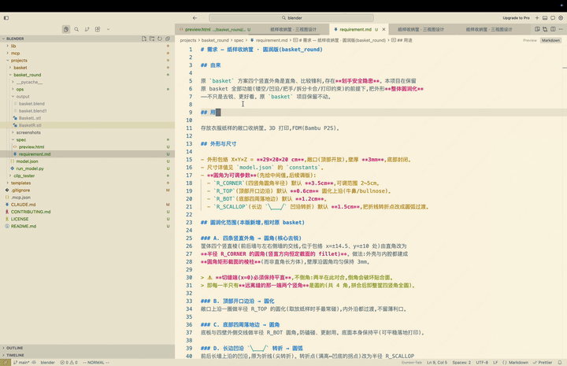

# spec-3d-model

**Design real, 3D-printable parts by chatting with your AI coding agent.**

Point Claude Code, Codex, or Cursor at this repo. Describe the part you want — it works out the
geometry with you, builds it in Blender, and hands you an STL that actually prints.

English · <a href="./README.zh-CN.md">中文</a>

---

## What is this?

You want a 3D-printed part — a bin, a bracket, a snap-fit clip. Today your options are bad:

- **AI mesh generators** (Shap-E, Rodin, Hunyuan3D…) give you a blob that *looks* right but is leaky, non-manifold, and impossible to edit. It won't print.
- **CAD** actually works, but you have to learn CAD.

spec-3d-model is a third way: **you talk to an AI agent, and the agent does the modeling** — with the engineering discipline that makes the result truly watertight and printable. Not a one-click generator; a method the agent follows so the geometry comes out *right*, and you can change any dimension later by editing one number.

## Quick start

**Prerequisites:** Blender ≥ 3.0, an MCP-capable agent (Claude Code / Codex / Cursor / …), [uv](https://github.com/astral-sh/uv).

1. **Clone this repo** and open it in your agent.
2. **Install the Blender addon** — in Blender: *Edit > Preferences > Add-ons > Install...*, pick `mcp/blender-mcp/addon.py`, enable **"Interface: Blender MCP"**. Then in the 3D View sidebar (`N`) → **BlenderMCP** tab → **Connect**. (The repo ships the MCP server config in [`.mcp.json`](./.mcp.json).)
3. **Just tell the agent what you want.** For example:
   > "I want an open-top storage bin, roughly 29×20×20 cm, 3 mm walls, with hex cutouts."

From there the agent runs the workflow for you:

| Step | What happens | Your part |
|---|---|---|
| **1. Talk it through** | The agent asks about dimensions, fit, how it'll be used. | Answer in plain language. |
| **2. Three-view sketch** | It hand-draws an orthographic `preview.html` (front / side / top, to scale). **This is the hard part** — AI has poor spatial sense, so this is where you correct the geometry. | Eyeball the drawing; fix what's wrong. **Approve before it builds.** |
| **3. Build + verify** | Once you approve, it writes the `model.json` spec and renders it in Blender, checking every part is watertight (boundary edges = 0). | Nothing — it's automatic. |
| **4. Export** | It exports print-ready STL(s), auto-split if the part is bigger than your print bed. | Send to your slicer. |

The three-view gate in step 2 is the whole trick: fixing a drawing is cheap, fixing a bad 3D model is expensive.

## Why it works

Under the hood, a part is **one JSON file = a single source of truth** (constants + object topology), built by a pure engine. That design buys the things AI 3D usually gets wrong:

- **Proof, not eyeballing.** Every part is measured with `manifold_report`; the bar is **boundary edges = 0** (truly watertight), reported honestly — an open bin shows its open rim, it doesn't fake a seal.
- **Printability baked in.** Cutters overhang so booleans leave no degenerate faces; hexes point up so FDM never bridges a flat span; seams carry keep-out bands.
- **Bigger than your print bed? Auto-split.** Parts over the build volume (e.g. Bambu 256³mm) split along the longest axis and reconnect with C-clip + pin snap-fits.
- **Parametric forever.** Change one constant (say a wall from 3 mm to 5 mm) and the whole part updates. No re-modeling.

Examples to look at: [`projects/clip_tester`](./projects/clip_tester) (a snap-fit test coupon — the smallest win), [`projects/basket`](./projects/basket) (a full bin, split for the bed). The engine internals live in [`lib/`](./lib) and are documented in [`lib/ENGINE.md`](./lib/ENGINE.md).

## Credits — built on BlenderMCP

spec-3d-model stands on the shoulders of **[BlenderMCP](https://github.com/MCPBlender/blender-mcp)**, the bridge that connects Blender to any LLM over the Model Context Protocol. **It's the foundation this project is built on** — without it, none of this exists, and we're grateful for it. If spec-3d-model is useful to you, please go star BlenderMCP too.

**Why the repo bundles a fork of it:** our workflow is inherently **multi-file** — a run script imports a shared engine and ops plus a `model.json`, all real files on disk that reference each other. Upstream runs Python by taking the **code inlined as a string** into the tool call, which can't express a project spread across files. So our fork under [`mcp/blender-mcp`](./mcp/blender-mcp) makes the execution tool **take a file path** instead (the server reads the script from disk), and injects `__file__` so scripts locate their own directories — zero hardcoded paths. Nothing is wrong with upstream; we'd gladly contribute this back.

## Contributing & license

New ops and new example parts are the most welcome contributions — see [CONTRIBUTING.md](./CONTRIBUTING.md). Licensed [MIT](./LICENSE); the vendored BlenderMCP fork keeps its own upstream license.
