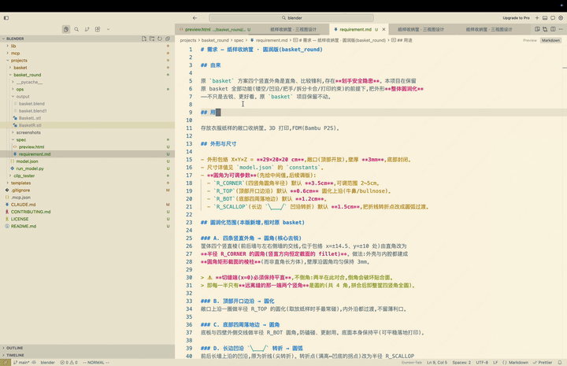

# spec-3d-model

**跟你的 AI 编程助手聊两句,就能设计出真正能打印的 3D 零件。**

把 Claude Code、Codex 或 Cursor 指向本仓库,说出你想要的零件——它会和你一起把几何理清楚,
在 Blender 里建出来,最后交给你一个真能打印的 STL。

<a href="./README.md">English</a> · 中文

---

## 这是什么?

你想打印一个零件——收纳筐、支架、卡扣。今天的选择都不太行:

- **AI 网格生成器**(Shap-E、Rodin、Hunyuan3D……):给你一个*看着*对的网格,却漏水、非流形、改不动。打不出来。
- **CAD**:确实能用,但你得先学会 CAD。

spec-3d-model 是第三条路:**你跟 AI 助手对话,建模的活由它来干**——而且带着让结果真正水密、真正能打印的工程纪律。它不是一键生成器,而是一套 AI 会遵循的方法,让几何*建对*;之后想改任何尺寸,改一个数就行。

## 快速上手

**前置**:Blender ≥ 3.0、一个支持 MCP 的 Agent(Claude Code / Codex / Cursor / …)、[uv](https://github.com/astral-sh/uv)。

1. **clone 本仓库**,在你的 Agent 里打开它。
2. **装 Blender 插件**——Blender 里:*编辑 > 偏好设置 > 插件 > 安装...*,选 `mcp/blender-mcp/addon.py`,启用 **"Interface: Blender MCP"**。然后在 3D 视图侧边栏(按 `N`)→ **BlenderMCP** 页 → **Connect**。(仓库已自带 MCP server 配置,见 [`.mcp.json`](./.mcp.json)。)
3. **直接告诉 Agent 你要什么。** 比如:
   > "我想要一个敞口收纳筐,大概 29×20×20cm,壁厚 3mm,墙上带六边形镂空。"

接下来 Agent 会替你跑完整个流程:

| 步骤 | 发生了什么 | 你要做的 |
|---|---|---|
| **1. 聊清需求** | Agent 问你尺寸、配合、怎么用。 | 用大白话回答。 |
| **2. 三视图草图** | 它手绘一份等比例正交三视图 `preview.html`(正 / 左 / 俯)。**这是最难的一步**——AI 空间感很差,所以这里要靠你把几何逻辑补清楚、纠正错误。 | 对着图看,改掉不对的地方。**确认无误后它才动手建。** |
| **3. 建模 + 校验** | 你确认后,它写出 `model.json` 配置并在 Blender 里渲染,同时核验每个件是否水密(边界边=0)。 | 什么都不用做,全自动。 |
| **4. 导出** | 它导出可直接打印的 STL;零件比打印床大就自动切件。 | 丢进切片器。 |

第 2 步的三视图闸门是整套方法的关键:改一张图很便宜,改一个建坏的 3D 模型很贵。

## 它为什么 work

底层上,一个零件就是**一份 JSON 文件 = 唯一真相源**(常量 + 对象拓扑),由一个纯引擎建出来。正是这个设计,换来了 AI 做 3D 通常做不到的几件事:

- **靠数据证明,不靠肉眼。** 每个件都用 `manifold_report` 量过,及格线是**边界边=0**(真水密),而且如实报告——敞口筐就显示它那圈开口,绝不假装封闭。
- **可打印性天生内建。** 切割器探出,布尔不留退化面;六边形尖顶朝上,FDM 不用悬空搭桥;切缝周围留禁孔带。
- **比打印床大?自动切件。** 超过打印体积(如 Bambu 256³mm)的件,沿最长轴切开,再用 C夹 + Pin 卡合重连。
- **永远参数化。** 改一个常量(比如壁厚 3mm 改 5mm),整个件跟着更新。不用重新建模。

可以看的示例:[`projects/clip_tester`](./projects/clip_tester)(卡合试配小件,最小可用件)、[`projects/basket`](./projects/basket)(完整收纳筐,超床切件)。引擎内部实现在 [`lib/`](./lib),说明见 [`lib/ENGINE.md`](./lib/ENGINE.md)。

## 致谢 —— 构建于 BlenderMCP 之上

spec-3d-model 站在 **[BlenderMCP](https://github.com/MCPBlender/blender-mcp)** 的肩膀上——它是把 Blender 通过 Model Context Protocol 接到任意 LLM 的桥梁。**它是本项目的地基**,没有它就没有这一切,我们心怀感激。如果 spec-3d-model 对你有用,也请去给 BlenderMCP 点个 star。

**为什么仓库里内置了一份它的 fork:** 我们的工作流天生是**多文件**的——一个 run 脚本 import 共享的引擎和 ops,再加一份 `model.json`,它们是磁盘上彼此引用的真实文件。上游执行 Python 的方式是把**代码作为字符串内联**进工具调用,无法表达一个跨多文件的工程。所以我们在 [`mcp/blender-mcp`](./mcp/blender-mcp) 下的 fork 把执行工具改成**收文件路径**(server 从磁盘读脚本),并注入 `__file__` 让脚本自己定位目录——零硬编码路径。上游本身没有任何问题;这个改动我们很乐意回贡。

## 贡献与协议

最受欢迎的贡献是**新 op** 和**新示例件**——见 [CONTRIBUTING.md](./CONTRIBUTING.md)。协议 [MIT](./LICENSE);内置的 BlenderMCP fork 保留其上游自己的协议。
